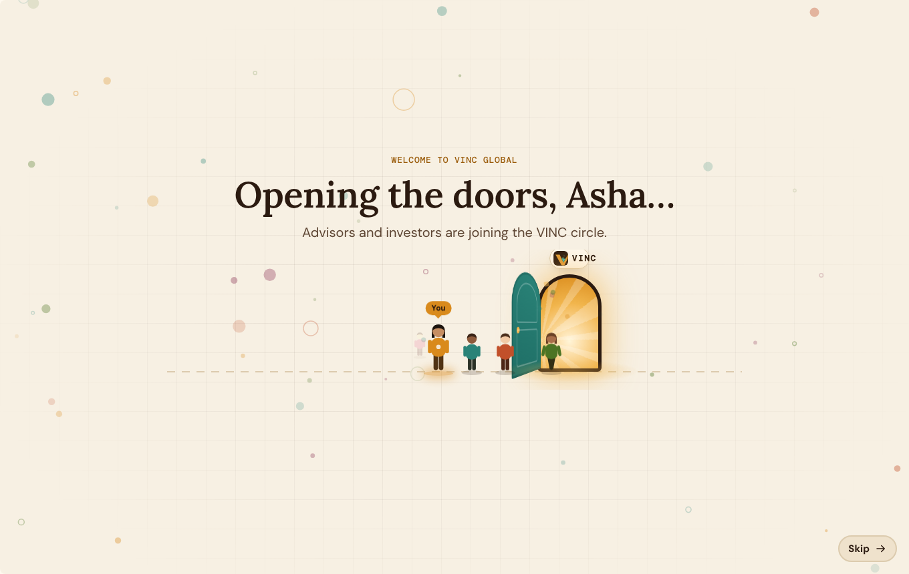
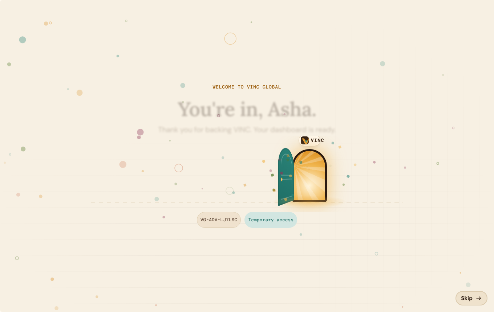
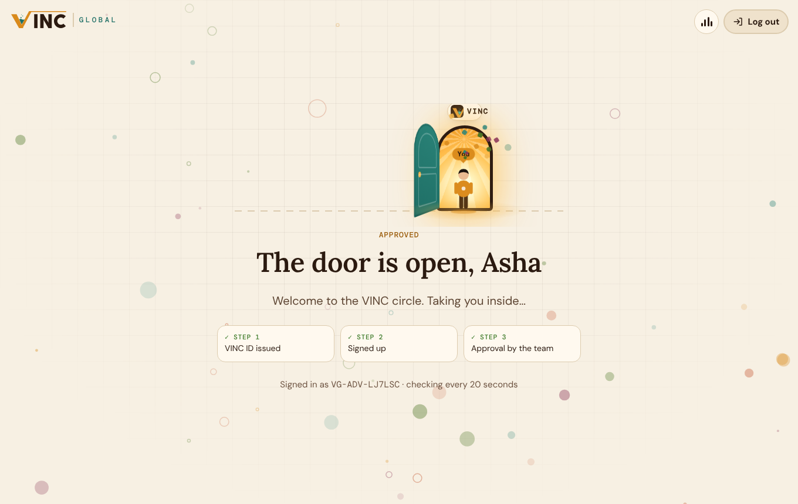
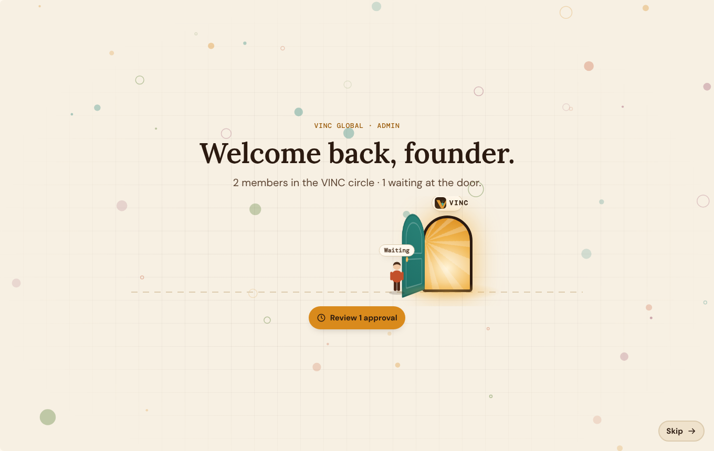
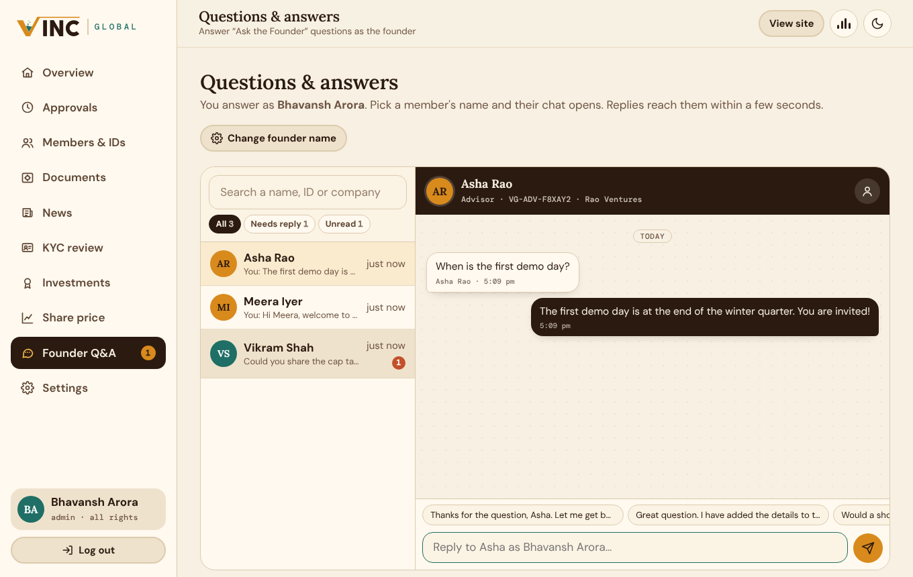
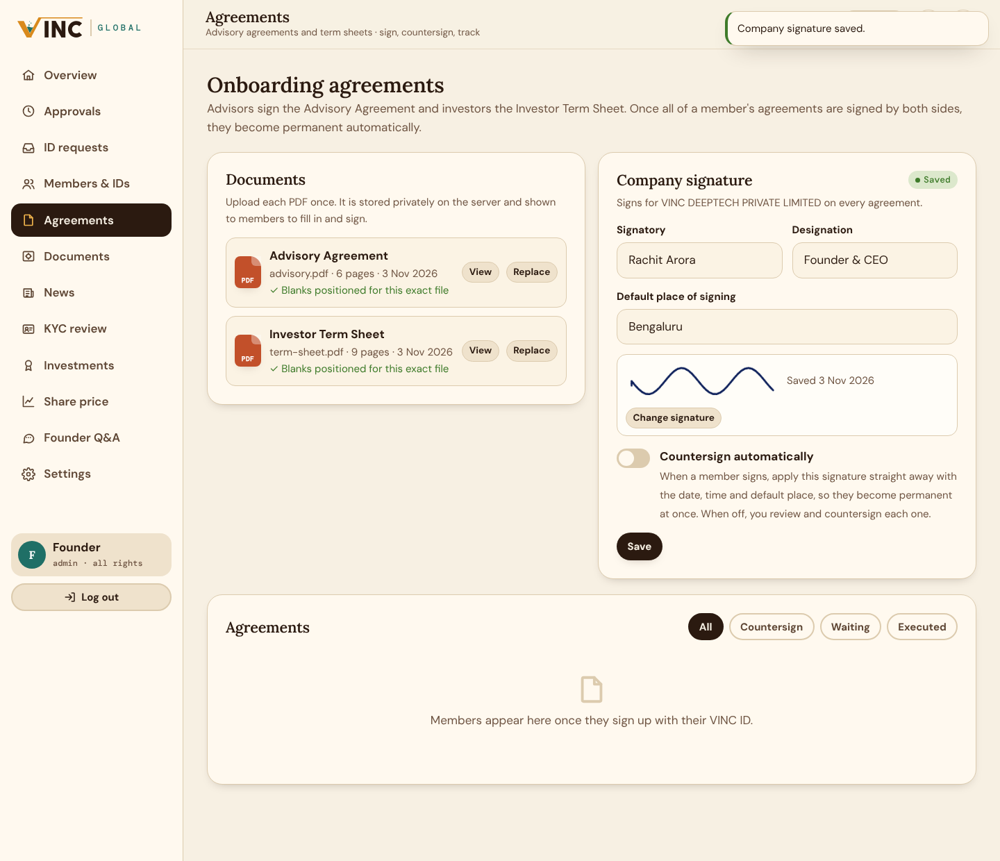

# VINC Global

The private portal for the advisors and investors behind VINC, for **vinc-global.com**.
It uses the same look as [vinc-lab.com](https://vinc-lab.com) and [lms.vinc-lab.com](https://lms.vinc-lab.com): cream paper, warm ink, the amber VINC mark, Lora / DM Sans / DM Mono, and light and dark themes.

## What's inside

**Public landing page (`/`)**: an introduction to the VINC Learning Centre and the Kaushal Bodh LMS, a "why now" timeline, a tour of the portal, the four onboarding steps, and public news.

**Admin (log in at `/login` with VINC ID `admin` and password `Vinc@2026`; there is one login form for everyone)** has all rights:
- **Members & IDs**: generate IDs for advisors (`VG-ADV-…`) or investors (`VG-INV-…`), with an optional custom ID, starting password and pre-approval. Copy an invitation message. Edit, revoke, reset or delete any member.
- **ID requests**: people who filled in **Request a VINC ID** on the website. **Generate ID & email it** creates their ID and emails it with a sign-up link.
- **Approvals**: approve a **temporary** window (72 hours by default; you can set custom hours) or **permanent** access, or reject.
- **Documents**: choose **Upload PDF**, **Upload Excel** or **Add a link**. Each item opens view-only in a panel on the same page, with a **Close** button at the top. You can share an item with all members or with one member.
- **News**: publish to members only, or to the public landing page as well. Posts can be pinned.
- **KYC review**: view each uploaded file, then verify it or reject it with a note.
- **Investments**: record each investment and upload share certificates.
- **Share price**: publish the actual price (the live price members see) and projected prices.
- **Founder Q&A**: the admin is the founder. Every member who has signed up is listed by name, with search and *All / Needs reply / Unread* filters. Choose a name and that advisor's chat opens, with their full history and quick replies. You can start a conversation with anyone. Replies are signed with the founder name set in **Settings**.
- **Welcome animation**: on login, members arrive and walk through the VINC door, and anyone awaiting approval is left "Waiting" at the door, with a shortcut to review them.
- **Agreements**: upload the Advisory Agreement and Investor Term Sheet and any other agreement, set up its blanks, send it to one member, a selection or a whole group, save the company signature, countersign (or sign automatically), view the executed PDFs and their audit trail, or void and ask for a fresh signature.
- **Settings**: company name, founder name, currency, the length of the temporary window, and the admin password.

**Advisor / investor (`/signup`, then `/advisor`)**:
- Sign up with the VINC ID from the team plus a password. The portal opens only after approval, and the waiting screen opens the portal by itself once you're approved.
- **72-hour timeline**: an animated track with a live countdown. When the window ends, the member clicks **Request access again**, and the request goes back to the admin's approvals queue.
- **Ask the Founder**: an animated floating button. Every conversation is saved and resumes when the button is clicked after each login. An unread badge shows new replies.
- **Data room**: board resolutions, registration documents, financials and more. Everything is view-only and watermarked with the member's ID and the date.
- **KYC**: upload PAN, Aadhaar, address proof, bank proof and a photo, and track each one's status.
- **My investment**: total invested, shares, the live share price (checked every 30 seconds), a chart of price history and projection, current and projected value, and downloadable share certificates.
- **Joining VINC animation**: right after login, people walk up in a queue and step through a glowing VINC doorway. The advisor's own figure, tagged "You", is last in line, and when it walks in there's a burst of confetti and the dashboard rises into place card by card. It plays once per login and can be skipped (button or Esc). People who prefer reduced motion don't see it. On the waiting-for-approval screen, the advisor stands at a closed door that swings open and lets them in when the team approves.
- **Calm ambience**: a soft generated soundscape (Web Audio: slow pads, gentle bells, a faint breath of air), toggled with the equaliser button. Browsers allow sound only after a click, so the portal remembers the choice and starts on the first click.

## Onboarding agreements

**Advisors** must sign the **Advisory Agreement** and the **Investor Term Sheet**; **investors** must sign the **Investor Term Sheet**. Both appear automatically in the member's Agreements section. The admin uploads the two PDFs once in **Admin → Agreements**. They are stored privately on the server and are never committed to this repository, which is public.

**Other agreements.** The admin can upload any PDF (an NDA, a side letter, an addendum):
- Its underscore blanks are found automatically. Next to a preview of the document, the admin sets what each one is for: the member fills it in (required or optional), fixed text typed once, the agreement date, a member's or the company's signature, date or place, or left blank.
- It can be marked **required for permanent membership** or optional.
- It is sent to selected members, all advisors, all investors or everyone, and each person gets an email.
- A signature page with both signatures, dates, times and places is added at the end, then the certificate page.
- It can be withdrawn; unsigned copies are voided and signed ones are kept.

- **Filling and signing.** The member fills in the blanks right on the document: name, S/o / D/o / W/o, address, PAN, email and phone; for the term sheet, residential status (the other option is struck out) and ticket size. They then sign by drawing or typing their name.
- **Captured at signing:** the date and time (IST), the place they enter, their IP address and device, and their location if they choose to share it.
- **Company signature.** The company side is signed for VINC DEEPTECH PRIVATE LIMITED by the signatory set in Admin → Agreements, with its own date, time and place. The admin either countersigns each agreement or switches on **Countersign automatically**, which applies the saved company signature as soon as a member signs.
- **The executed PDF** is the original document with the blanks filled and both signatures. Every page carries a reference, and a final signature-certificate page records both signers, the times, the places, IPs, the consent text and the full audit trail. It is emailed to the member and the admin, and its SHA-256 fingerprint is kept.
- **Permanent membership.** Once every required agreement is executed, the member becomes **permanent** automatically. Optional agreements do not affect this. The admin can void an agreement to have it signed again.
- **Where the blanks are.** Field positions live in `server/agreements.js`, measured on the supplied PDFs; the admin page shows whether an uploaded file is the exact measured version.

## Email

The portal emails from `info@vinc-global.com` through one.com's SMTP server. The settings live in a `.env` file on the server (see `.env.example`); the password is never stored in the repo.

| When | Who gets it |
|---|---|
| A VINC ID is generated with an email address, or a website request is approved | The member: their VINC ID and a sign-up link |
| The admin approves access (temporary or permanent) | The member |
| News, a new document, a new share price, a reply from the founder | Active members (each member can turn these off under **Account**) |
| KYC verified or rejected, investment recorded, certificate issued | The member |
| Sign-up, renewal request, new question, KYC upload, website ID request | The admin (`ADMIN_EMAIL`) |
| Someone submits **Request a VINC ID** | That person: "we received your request" |

**Settings → Email** shows whether email is connected, sends a test email and lists the last 40 emails with their status. Reply emails are limited to one every 15 minutes per member.

## Run it

Requires **Node.js 22.5+**. The database is Node's built-in SQLite, so there's nothing native to compile.

```bash
npm install
npm start            # http://localhost:3000
npm test             # API tests against a throwaway database
```

Data (database + uploads) is stored in `./data` unless `DATA_DIR` is set. See `.env.example` for all settings.

### Deploy to vinc-global.com

Any VPS works: Lightsail, a DigitalOcean droplet, EC2 or similar.

```bash
git clone -b claude/wizardly-thompson-x44m2x https://github.com/bhavansh-arora/vinc-global.git /opt/vinc-global
cd /opt/vinc-global && docker compose up -d --build     # listens on 127.0.0.1:3010 only
curl -s http://127.0.0.1:3010/healthz                   # {"ok":true}
```

The database and uploads live in the `vinc-global-data` Docker volume. To update later, run `git pull && docker compose up -d --build`; the data stays. To back up, run `docker run --rm -v vinc-global-data:/data -v $PWD:/b alpine tar czf /b/vinc-global-backup.tgz -C /data .`

Put nginx or Caddy in front with HTTPS (Caddy: `vinc-global.com { reverse_proxy localhost:3000 }`), and set `client_max_body_size 30m;` if you use nginx.

**Before going live:**
1. Log in as `admin` / `Vinc@2026` and change the password under **Settings** straight away.
2. Run with HTTPS and `NODE_ENV=production`, so the login cookie is marked Secure.
3. Back up the `DATA_DIR` folder, which holds the database and every uploaded file.

## Notes on "view only"

PDFs are drawn page by page with PDF.js, with no download or print buttons. Excel files are read on the server and only the cell text is sent, so the workbook never reaches the browser. Every view carries a watermark with the viewer's ID and the date. Right-click, Ctrl/Cmd+S/P/C and printing are blocked while a document is open, and files are served with `no-store`. This stops casual copying, not a determined person with a screenshot tool, which no website can prevent. Views and downloads are recorded in each member's activity log.

Some websites refuse to be shown inside another page (lms.vinc-lab.com is one). For links like these, the viewer offers **Open in new tab**.

## Project layout

```
server/        Express app, SQLite schema, auth, routes (auth, member, admin, chat, files)
public/        Landing, login, sign-up, advisor and admin pages; css/ and js/
test/          node:test API tests
```

## Screenshots

| | |
|---|---|
|  |  |
|  |  |
|  |  |
|  |  |
|  |  |
|  |  |
|  |  |
