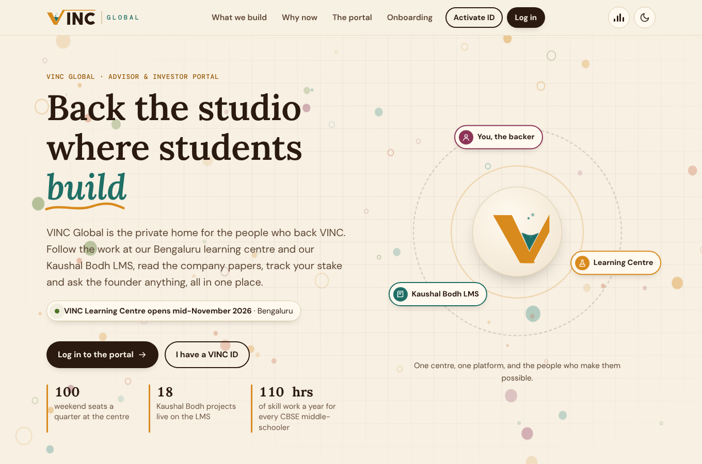
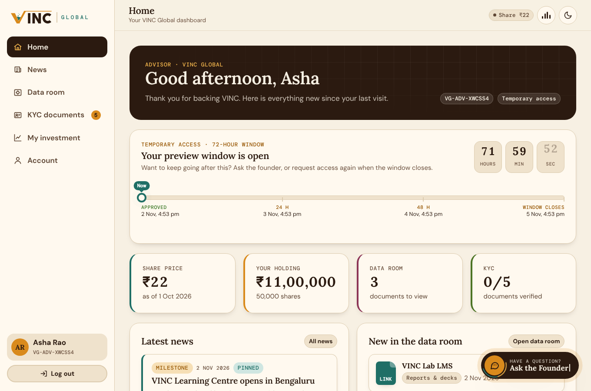
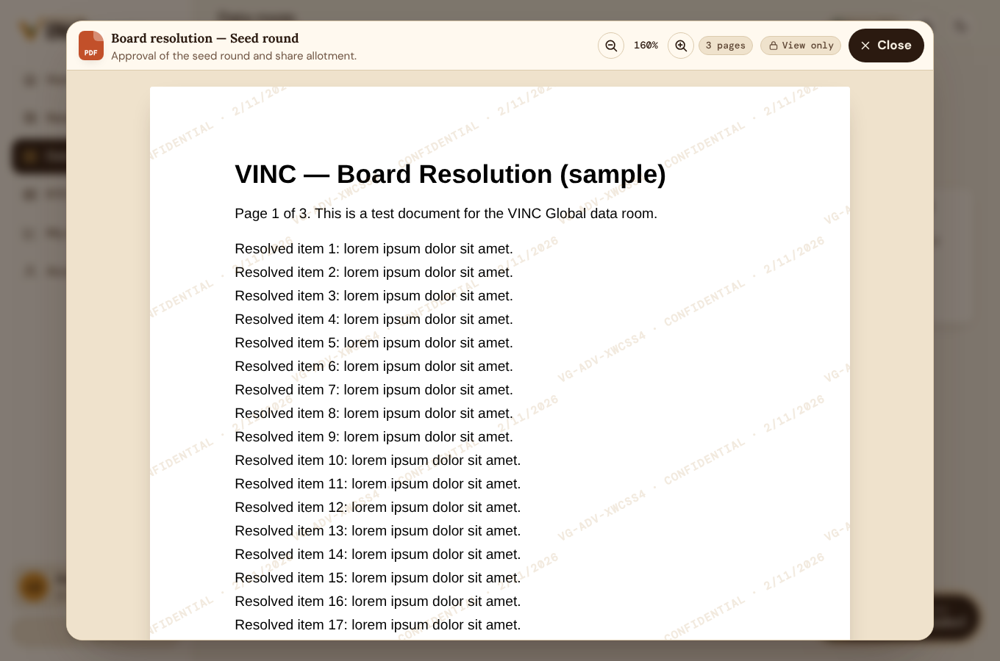
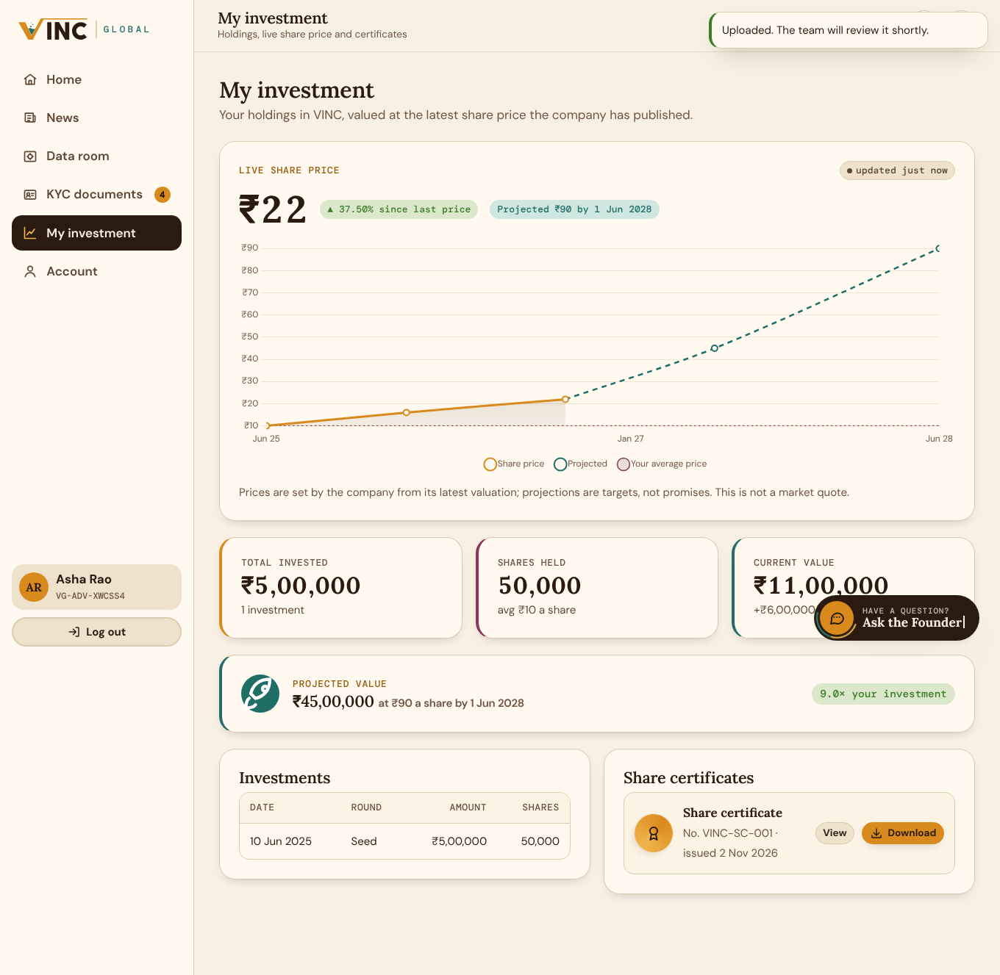
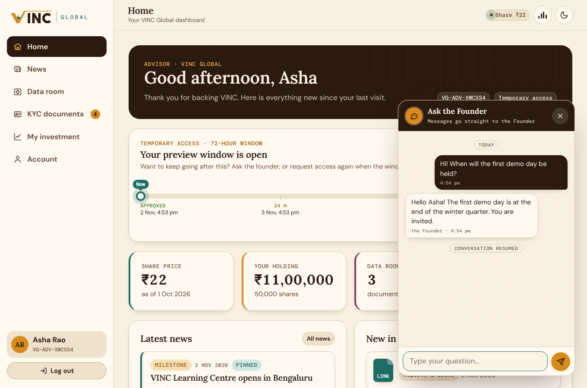
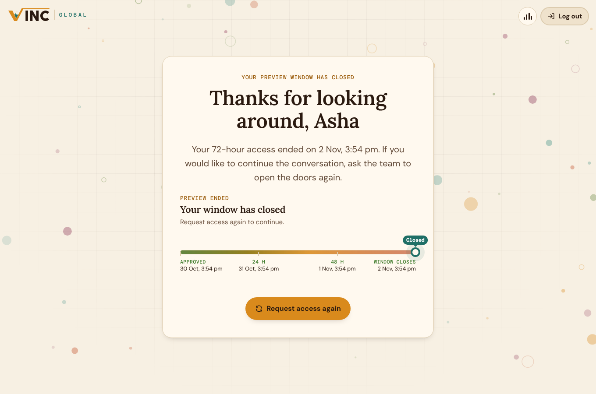
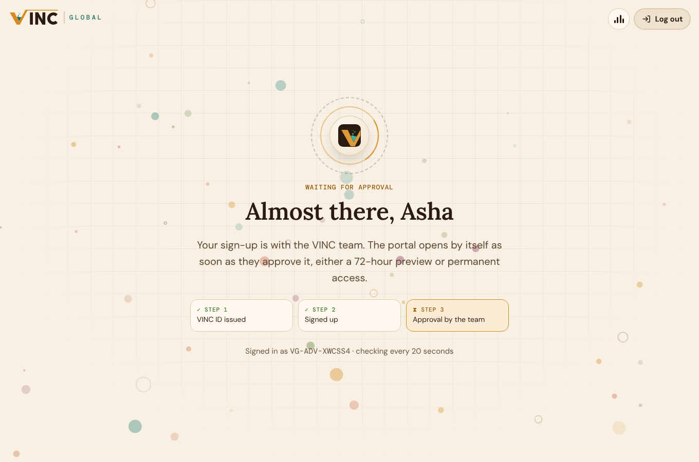
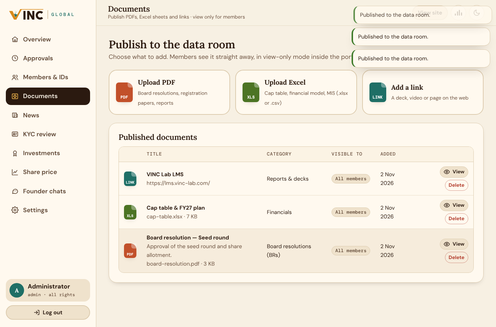

# VINC Global

The private portal for the advisors and investors behind VINC, for **vinc-global.com**.
It uses the same look as [vinc-lab.com](https://vinc-lab.com) and [lms.vinc-lab.com](https://lms.vinc-lab.com): cream paper, warm ink, the amber VINC mark, Lora / DM Sans / DM Mono, and light and dark themes.

## What's inside

**Public landing page (`/`)**: an introduction to the VINC Learning Centre and the Kaushal Bodh LMS, a "why now" timeline, a tour of the portal, the four onboarding steps, and public news.

**Admin (`/login` → Admin, default `admin` / `Vinc@2026`)** has all rights:
- **Members & IDs**: generate IDs for advisors (`VG-ADV-…`) or investors (`VG-INV-…`), with an optional custom ID, starting password and pre-approval. Copy an invitation message. Edit, revoke, reset or delete any member.
- **Approvals**: approve a **temporary** window (72 hours by default; you can set custom hours) or **permanent** access, or reject.
- **Documents**: choose **Upload PDF**, **Upload Excel** or **Add a link**. Each item opens view-only in a panel on the same page, with a **Close** button at the top. You can share an item with all members or with one member.
- **News**: publish to members only, or to the public landing page as well. Posts can be pinned.
- **KYC review**: view each uploaded file, then verify it or reject it with a note.
- **Investments**: record each investment and upload share certificates.
- **Share price**: publish the actual price (the live price members see) and projected prices.
- **Founder chats**: answer "Ask the Founder" questions, or start a conversation.
- **Settings**: company name, founder name, currency, the length of the temporary window, and the admin password.

**Advisor / investor (`/signup`, then `/advisor`)**:
- Sign up with the VINC ID from the team plus a password. The portal opens only after approval, and the waiting screen opens the portal by itself once you're approved.
- **72-hour timeline**: an animated track with a live countdown. When the window ends, the member clicks **Request access again**, and the request goes back to the admin's approvals queue.
- **Ask the Founder**: an animated floating button. Every conversation is saved and resumes when the button is clicked after each login. An unread badge shows new replies.
- **Data room**: board resolutions, registration documents, financials and more. Everything is view-only and watermarked with the member's ID and the date.
- **KYC**: upload PAN, Aadhaar, address proof, bank proof and a photo, and track each one's status.
- **My investment**: total invested, shares, the live share price (checked every 30 seconds), a chart of price history and projection, current and projected value, and downloadable share certificates.
- **Calm ambience**: a soft generated soundscape (Web Audio: slow pads, gentle bells, a faint breath of air), toggled with the equaliser button. Browsers allow sound only after a click, so the portal remembers the choice and starts on the first click.

## Run it

Requires **Node.js 22.5+**. The database is Node's built-in SQLite, so there's nothing native to compile.

```bash
npm install
npm start            # http://localhost:3000
npm test             # API tests against a throwaway database
```

Data (database + uploads) is stored in `./data` unless `DATA_DIR` is set. See `.env.example` for all settings.

### Deploy to vinc-global.com

Any VPS works: Lightsail, a DigitalOcean droplet, EC2 or similar.

```bash
docker build -t vinc-global .
docker run -d --name vinc-global -p 3000:3000 -v /srv/vinc-global:/data -e TRUST_PROXY=1 vinc-global
```

Put nginx or Caddy in front with HTTPS (Caddy: `vinc-global.com { reverse_proxy localhost:3000 }`), and set `client_max_body_size 30m;` if you use nginx.

**Before going live:**
1. Log in as `admin` / `Vinc@2026` and change the password under **Settings** straight away.
2. Run with HTTPS and `NODE_ENV=production`, so the login cookie is marked Secure.
3. Back up the `DATA_DIR` folder, which holds the database and every uploaded file.

## Notes on "view only"

PDFs are drawn page by page with PDF.js, with no download or print buttons. Excel files are read on the server and only the cell text is sent, so the workbook never reaches the browser. Every view carries a watermark with the viewer's ID and the date. Right-click, Ctrl/Cmd+S/P/C and printing are blocked while a document is open, and files are served with `no-store`. This stops casual copying, not a determined person with a screenshot tool, which no website can prevent. Views and downloads are recorded in each member's activity log.

Some websites refuse to be shown inside another page (lms.vinc-lab.com is one). For links like these, the viewer offers **Open in new tab**.

## Project layout

```
server/        Express app, SQLite schema, auth, routes (auth, member, admin, chat, files)
public/        Landing, login, sign-up, advisor and admin pages; css/ and js/
test/          node:test API tests
```

## Screenshots

| | |
|---|---|
|  |  |
|  |  |
|  |  |
|  |  |
